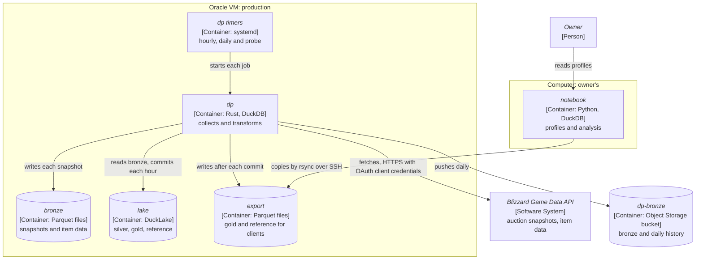
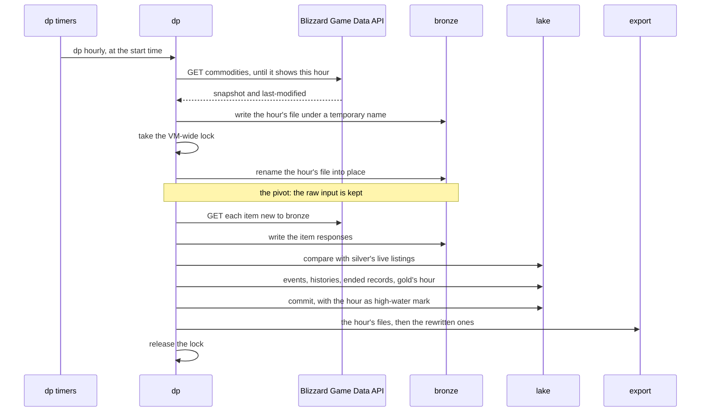

# Architecture

Dark Portal's parts, where they run and how the hourly data flows through
them, as a C4 deployment view and a dynamic view. The technologies are chosen
in [5.1.3](5.1.3-technology-decisions.md). Each environment's folders, users
and timers on its host are designed in #11.

> **Draft for #7's design.** Covers stage 1, the EU commodities. Items sold on
> a realm's own auction house join with stage 4 (#10).

## The auction house, as the data shows it

- **Commodities** are traded region-wide: one EU house holds a queue for each
  commodity, ordered by unit price ascending, then by auction ID descending, so
  the head is the cheapest and, at that price, the newest. A buyer takes units
  from the head, and one purchase can take several listings; a seller posts,
  and may cancel; a listing expires after 12, 24 or 48 hours. The house takes a
  5% cut of each sale.
- **Auction IDs** increase between snapshots: every new ID is above the
  previous snapshot's highest. So ID order is posting order across snapshots.
  Within one snapshot it is approximate, since IDs are sometimes issued out of
  order by a few.
- **Other items** (gear) are traded on each connected realm's own house, with
  bids and buyouts, and each listing is one distinct item.
- **A snapshot** is the state of every queue at one moment, published about
  hourly. Sales are not published: every event is inferred from the difference
  between two snapshots ([5.2.2](5.2.2-listing-lifecycle-and-events.md)).

## Containers and where they run

**One image, one binary.** `dp` is a thin Rust shell with a subcommand per job;
its logic is DuckDB SQL, shipped in the image.

| Subcommand | Does | Started by |
| --- | --- | --- |
| `dp hourly` | `collect`, `items`, `transform` and `export`, in that order | the hourly timer |
| `dp collect` | fetches the hour's snapshot into bronze ([5.2.1](5.2.1-collection.md)) | `dp hourly`, or a person |
| `dp items` | fetches item data for item IDs new to bronze ([5.2.1](5.2.1-collection.md#item-data)) | `dp hourly`, or a person |
| `dp transform` | processes every bronze hour after the high-water mark ([5.2.2](5.2.2-listing-lifecycle-and-events.md)) | `dp hourly`, or a person |
| `dp export` | writes the export ([5.4.2](5.4.2-storage-schema.md#the-export)) | `dp hourly`, or a person |
| `dp daily` | closes the day, pushes bronze and the daily history to the bucket, deletes rows and files past their keep time and retries items that answered 404 | the daily timer |
| `dp probe` | asks Blizzard once a day when the snapshot was last refreshed and warns where that is more often than hourly ([5.2.1](5.2.1-collection.md#the-refresh-probe)); writes nothing and takes no lock | the probe timer |

**Every client reads the same SQL.** The views and macros over gold ship in the
image and in the export, so a client computes no measure of its own.

## The hourly run

**The bronze file is the run's
[*pivot*](https://github.com/delphside/programme/blob/main/docs/1.10-development-standards.md#when-an-error-stops-the-run)**,
the step after which its change is kept.

- Everything before it can be fetched again within the hour, so the run
  retries, and an hour still unfetched when the retry window closes is a
  gap.
- Everything after it is safe to rerun: `dp transform` reads the *high-water
  mark*, the last hour committed, and processes every bronze hour after it, in
  order; `dp export` writes every committed hour within the hourly keep that the
  export lacks. So a failed transform or export is repaired by the next run.
- `dp hourly` runs `items`, `transform` and `export` whatever `collect`
  returned, so a pending hour is caught up even when this hour's snapshot is
  late.

**Writing jobs take turns.** Every `dp` subcommand that writes takes the
VM-wide lock, whether a timer or a person starts it, so no two overlap.
`dp collect` takes it only to rename its file into place, so one environment
waiting for a late snapshot holds up no other; `dp hourly` then holds it,
without release, from that rename through `export`. Where `collect` took none
(its hour was collected already, or it failed first), `dp hourly` takes it for
`items`. An ad hoc query is not built yet; it waits on
[#51 *Ad hoc query on the host*](https://github.com/delphside/dark-portal/issues/51).

## Restarts and recovery

- **A reboot** loses no hour that can still be fetched: the hourly and daily
  timers are persistent, so a run missed while the host was down starts when it
  is back, and `dp collect` takes the current hour. The probe timer is not: a
  probe run late would meet the refresh it samples at another time, so a host
  down at 12:05 gets no probe until the next day's.
- **`dp daily` retries itself.** A run that exits `75`, such as when a late
  hourly run holds the lock, or that has too little time left before its
  deadline to close ([5.4.2](5.4.2-storage-schema.md#the-daily-deadline)),
  releases the lock, waits the daily retry interval and runs again, for as long
  as the next attempt would start before the daily retries end, or the daily
  retries span after the run started where that is earlier
  ([5.4.1](5.4.1-configuration.md#product-settings)). It exits with
  the last attempt's status, so `75` where the retries ran out, and a start
  after the end, such as a persistent timer's catch-up, makes one attempt. The
  unit does not restart it ([`dp-daily@.service`](../deploy/systemd/dp-daily@.service));
  nor does the hourly one, whose next timer start is its retry.
- **The backup is bronze, and the daily history.** The bucket holds bronze for
  the bronze keep in the bucket, and the export's `item_day` and `item` files
  indefinitely ([5.4.2](5.4.2-storage-schema.md#the-bucket)). After a lost
  host, `item_day` and `item` for what is older than bronze are restored from
  the bucket, and everything else is rebuilt from bronze: a rebuild replays
  bronze in order from its first hour, and gives the same silver and gold as an
  incremental run from that hour. The restore's steps are in
  #38 *Restore Dark Portal after a lost host*.
- **`dp daily`'s pivot is the day's commit**, which closes the day. It exits:
  - `75` where the lock is held past the lock wait, the day before cannot yet
    be closed, or too little time is left before the daily deadline to close;
  - `2` where a technical, fundamental error stops it before the pivot, such
    as `LAKE_UNAVAILABLE`, a full disk, or DuckDB out of memory in opening the
    lake, migrating it, loading the profiles or the close; and `70` on an
    unexpected error there;
  - `3` where the export, a push, a deletion, the clearing of temporary files
    or an item retry fails after the pivot, or is left because the daily
    deadline passed ([5.4.2](5.4.2-storage-schema.md#the-daily-deadline)),
    which the next run repeats;
  - otherwise `0`, an item that answers 404 again included.
- **Reference is fetched once per item** in stage 1; a later stage refreshes it
  when a game patch changes vendor prices.

## Data layers

| Layer | Holds | Rebuilt from |
| --- | --- | --- |
| bronze | each snapshot as Parquet columns, and each item response as fetched | nothing: kept on the host and in the bucket for the times [5.4.1](5.4.1-configuration.md#product-settings) sets |
| meta | the hours processed and the hours missed, and the days closed and warned of | bronze, except the days closed, which are also taken from `item_day`'s rows, and the days warned of, which are not rebuilt |
| silver | live listings and their hourly history, events and ended listings' records | bronze |
| gold | per item per hour and per day: prices, depth and flows | bronze, by replaying it; `item_day` older than bronze is restored from the bucket |
| reference | items, with names, classes and vendor prices | bronze; items older than bronze are restored from the bucket |

Bronze is plain Parquet, readable without the catalog. Meta, silver, gold and
reference are DuckLake tables, so an hour's changes commit together or not at
all. The files and tables are in [5.4.2](5.4.2-storage-schema.md).
