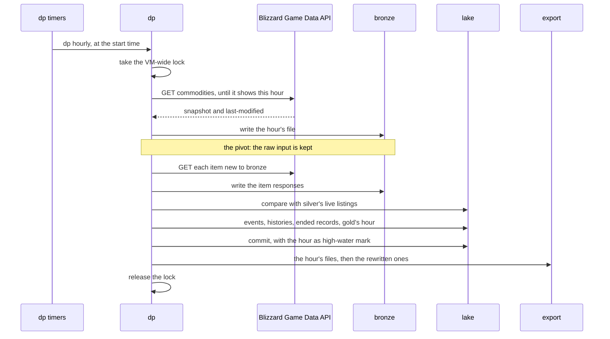

# Architecture

Dark Portal's parts, where they run and how the hourly data flows through
them, as a C4 deployment view and a dynamic view. The technologies are chosen
in [5.1.3](5.1.3-technology-decisions.md). Each environment's folders, users
and timers on its host are designed in #11.

> **Draft for #7's design.** Covers stage 1, the EU commodities. Items sold on
> a realm's own auction house join with stage 4 (#10).

## The auction house, as the data shows it

- **Commodities** are traded region-wide: one EU house holds a queue for each
  commodity, ordered by unit price ascending, then by auction ID descending, so
  the head is the cheapest and, at that price, the newest. A buyer takes units
  from the head, and one purchase can take several listings; a seller posts,
  and may cancel; a listing expires after 12, 24 or 48 hours. The house takes a
  5% cut of each sale.
- **Auction IDs** increase between snapshots: every new ID is above the
  previous snapshot's highest. So ID order is posting order across snapshots.
  Within one snapshot it is approximate, since IDs may be issued out of order
  by a few.
- **Other items** (gear) are traded on each connected realm's own house, with
  bids and buyouts, and each listing is one distinct item.
- **A snapshot** is the state of every queue at one moment, published about
  hourly. Sales are not published: every event is inferred from the difference
  between two snapshots ([5.2.2](5.2.2-listing-lifecycle-and-events.md)).

## Containers and where they run

**One image, one binary.** `dp` is a thin Rust shell with a subcommand per job;
its logic is DuckDB SQL, shipped in the image.

| Subcommand | Does | Started by |
| --- | --- | --- |
| `dp hourly` | `collect`, `items`, `transform` and `export`, in that order | the hourly timer |
| `dp collect` | fetches the hour's snapshot into bronze ([5.2.1](5.2.1-collection.md)) | `dp hourly`, or a person |
| `dp items` | fetches item data for item IDs new to bronze ([5.2.1](5.2.1-collection.md#item-data)) | `dp hourly`, or a person |
| `dp transform` | processes every bronze hour after the high-water mark ([5.2.2](5.2.2-listing-lifecycle-and-events.md)) | `dp hourly`, or a person |
| `dp export` | writes the export ([5.4.2](5.4.2-storage-schema.md#the-export)) | `dp hourly`, or a person |
| `dp daily` | closes the day, deletes rows past their keep time, and pushes bronze to the bucket | the daily timer |

**Every client reads the same SQL.** The views and macros over gold ship in the
image and in the export, so a client computes no measure of its own.

## The hourly run

**The bronze file is the run's
[*pivot*](https://github.com/delphside/programme/blob/main/docs/1.10-development-standards.md#when-an-error-stops-the-run)**,
the step after which its change is kept. Everything before it can be fetched
again within the hour, so the run retries. Everything after it is safe to
rerun: `dp transform` reads the high-water mark and processes every bronze hour
after it, in order. So a failed transform is repaired by the next run, and a
missed fetch is a gap.

**Scheduled jobs take turns.** Every scheduled job takes the VM-wide lock, so
the hourly and daily runs never overlap. An ad hoc query takes no lock; its
DuckDB `memory_limit` and `threads` bound it instead
([5.4.1](5.4.1-configuration.md)).

## Data layers

| Layer | Holds | Rebuilt from |
| --- | --- | --- |
| bronze | each snapshot as Parquet columns, and each item response as fetched | nothing: kept on the host for the days 5.4.1 sets, and in the bucket for a year |
| silver | live listings and their hourly history, events, and ended listings' records | bronze |
| gold | per item per hour and per day: prices, depth and flows | silver |
| reference | items, with names, classes and vendor prices | bronze |

Bronze is plain Parquet, readable without the catalog. Silver, gold and
reference are DuckLake tables, so an hour's changes commit together or not at
all. The files and tables are in [5.4.2](5.4.2-storage-schema.md).
