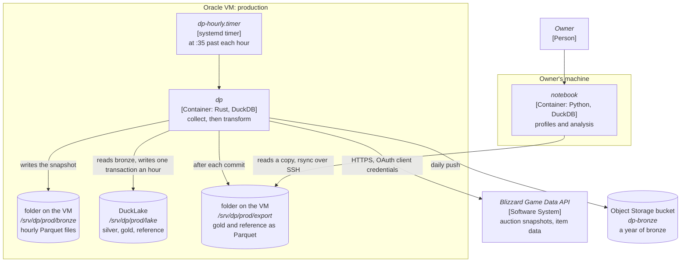
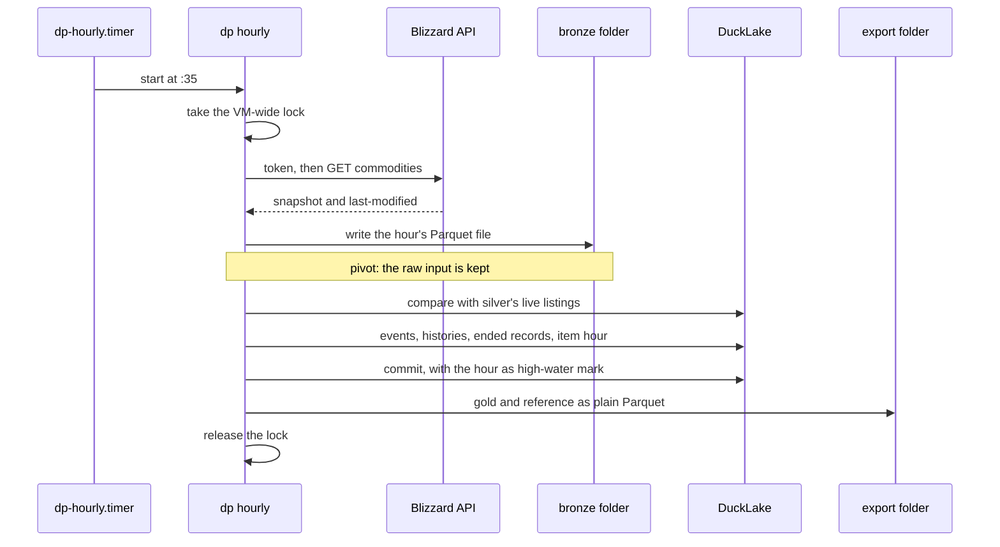

# Architecture

Dark Portal's parts and how the hourly data flows through them, as C4
container and dynamic views. The technologies are chosen in
[5.1.3](5.1.3-technology-decisions.md); each environment's layout on its host
is in the programme's Dark Portal records.

> **Draft for #7's design.** Covers stage 1, the EU commodities. Items sold on
> a realm's own auction house join with WP E.

## The auction house, as the data shows it

- **Commodities** are traded region-wide: one EU house holds a queue for each
  commodity, ordered by unit price ascending, then newest first. A buyer takes
  units from the head; a seller posts, and may cancel; a listing expires after
  12, 24 or 48 hours. The house takes a 5% cut of each sale.
- **Other items** (gear) are traded on each connected realm's own house, with
  bids and buyouts, and each listing is one distinct item.
- **A snapshot** is the state of every queue at one moment, published about
  hourly. Sales are not published: every event is inferred from the difference
  between two snapshots ([5.2.2](5.2.2-listing-lifecycle-and-events.md)).

## Containers

**One image, one binary.** `dp` is a thin Rust shell with a subcommand per
job. Its logic is DuckDB SQL: the views, macros and migrations ship inside the
image, and every client reads the same views and adds no logic.

**Bronze is files, the rest is a lakehouse.** Bronze is plain Parquet, one file
per snapshot, readable without the catalog and the only layer that cannot be
rebuilt. Silver, gold and reference are DuckLake tables over Parquet, with a
SQLite catalog, so an hour's changes commit together or not at all.

**Clients read an export.** After each commit `dp` writes gold and reference
as plain Parquet to the export folder, replacing each file by a rename, so a
copy is always consistent and a client needs no DuckLake. The owner pulls the
folder with rsync over SSH.

## The hourly run

**The pivot is the bronze file.** Before it, a failure loses nothing that
cannot be fetched again within the hour, so the run retries. After it, the
transform is safe to rerun: it reads the high-water mark and processes every
bronze hour after it, in order. So a failed transform is repaired by the next
run, and a missed fetch is a gap
([5.2.1](5.2.1-collection.md)).

**Collection comes first.** The lock keeps an ad hoc query from overlapping
the hourly run, and each job has its own DuckDB `memory_limit` and `threads`
([5.4.1](5.4.1-configuration.md)).

## Data layers

| Layer | Holds | Rebuilt from |
| --- | --- | --- |
| bronze | each snapshot as fetched, and Blizzard's item data as fetched | nothing: kept on the host for a few days and in the bucket for a year |
| silver | live listings and their hourly history, events, ended listings' records | bronze |
| gold | per item per hour and per day: prices, depth, flows | silver |
| reference | items, with names, classes and vendor prices | bronze |

The tables are in [5.4.2](5.4.2-storage-schema.md).
