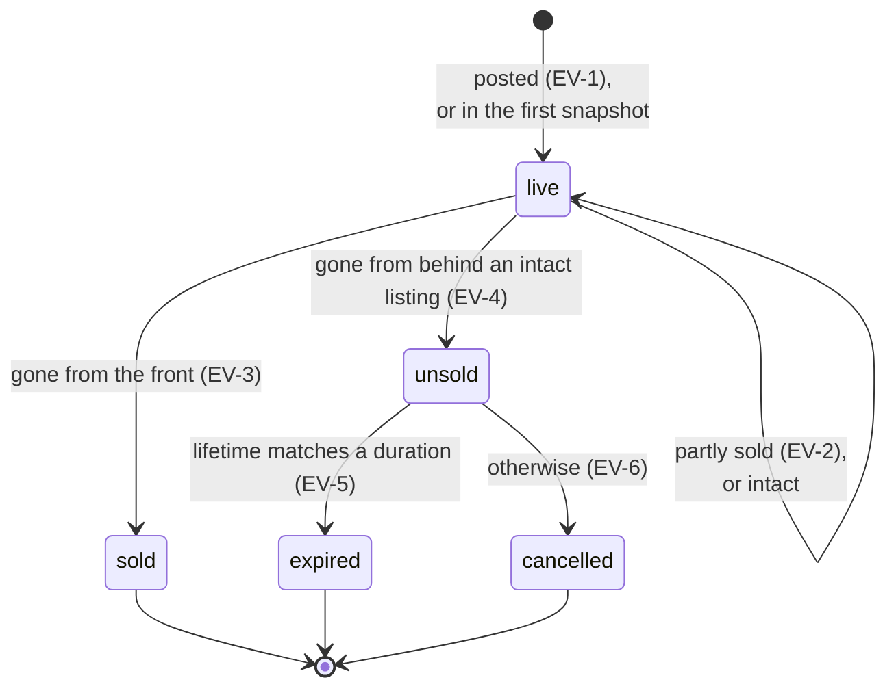

# Listing lifecycle and events

How `dp transform` turns each new snapshot of the EU commodities auction house
into the events that happened since the one before, and what each event
changes. The queue it rests on is in
[5.1.1](5.1.1-architecture.md#the-auction-house-as-the-data-shows-it); the
tables are in [5.4.2](5.4.2-storage-schema.md) and their columns and types in
[5.4.5](5.4.5-data-dictionary.md).

> **Draft for #7's design.** Covers commodities only. Items sold on a realm's
> own auction house (gear) have their own lifecycle, written with stage 4
> (#10).

## Times

A snapshot's hour is the *hour starting* of its `last-modified` time: a
snapshot modified at 01:31:40 is hour 01:00. Every event is dated by the hour
of the snapshot that first showed it. A *duration* is the difference of two
such hours, so a recorded duration *n* means between *n − 1* and *n + 1*
hours.

## How sure a fact is

Every fact carries a *tier*:

- **observed**: read from a snapshot, such as a listing's quantity;
- **certain**: deduced from two snapshots with no assumption;
- **inferred**: deduced with an assumption the rule names.

An inference can be recomputed when its rule changes, without touching the
facts beneath it.

## A listing's states

A *live* listing is a row in silver's live listings, with one history row for
every hour it was seen: its quantity, its time-left band and its place in the
queue. When it ends, its listing record is written and its live rows are
deleted. *Unsold* is a step in deciding, not a state a listing rests in: each
unsold listing ends expired or cancelled in the same comparison.

## The events

The comparison takes silver's live listings, as of the last hour processed,
and the current snapshot *C*. For each item, it orders the live listings as
the queue and marks each one:

- **intact**: in *C* with the same quantity;
- **reduced**: in *C* with a lower quantity;
- **gone**: not in *C*.

The *front* of an item's queue is every listing ahead of its first intact
listing. With no intact listing, the whole queue is the front.

| Event | When | Units | Tier | Rule |
| --- | --- | --- | --- | --- |
| posted | an ID in *C* not live | its quantity | certain | EV-1 |
| partly sold | a reduced listing | the drop | certain | EV-2 |
| sold | a gone listing in the front | its quantity | inferred | EV-3 |
| expired | a gone listing behind an intact one, whose lifetime matches a duration | its quantity | inferred | EV-4, EV-5 |
| cancelled | any other gone listing behind an intact one | its quantity | inferred | EV-4, EV-6 |

**EV-1**: a new ID is a posting. An ID at or below the highest live ID is
recorded as an anomaly, since IDs increase between snapshots.

**EV-2**: a quantity drop is a partial sale. A reduced listing behind an
intact one is recorded as an anomaly as well as a sale, since buyers take from
the head.

**EV-3**: a listing gone from the front was sold. Inferred, because a seller
can cancel a listing at the head.

**EV-4**: a listing gone from behind an intact one is unsold. Certain, except
where the intact listing ahead of it has the same price and was first seen in
the same snapshot: their order then rests on ID order within one snapshot, and
the event is marked as a *tie*.

**EV-5**: an unsold listing expired when its posting hour plus 12, 24 or 48
hours falls between the hour *span* hours before the current one and the
current hour, inclusive. Where its posting hour is unknown, it expired when
its last time-left band was `SHORT` or `MEDIUM`, the only bands that can run
out within an hour.

**EV-6**: every other unsold listing was cancelled.

Each gone listing writes one event, expired, cancelled or sold, with its rule
and tier. So the certain fact that a listing was unsold is kept apart from the
inferred choice between expired and cancelled.

### A missed hour

A missed snapshot is lost, since Blizzard keeps no history. The next
comparison then runs from the live listings to the current snapshot, and every
event it finds is dated to the current hour, with its *span*: the hours since
the last snapshot held. The listings it first sees have no posting hour.

## What each event changes

The entity/event matrix: **C** creates a row, **U** updates one, **R** reads,
**D** deletes. *Intact* is a mark, not an event, and is listed because it
writes a history row.

| Event or step | Bronze snapshot | Live listing | Listing history | Event | Listing record | Gold hour | Gold day |
| --- | --- | --- | --- | --- | --- | --- | --- |
| snapshot collected | C | | | | | | |
| posted | R | C | C | C | | | |
| intact | R | U | C | | | | |
| partly sold | R | U | C | C | | | |
| sold, expired or cancelled | R | D | D | C | C | | |
| hour closed | | R | | R | | C | |
| day closed | | | | | | R | C |

*Gold hour* is `item_hour` and `price_level_hour`, written once the hour's
events are in: prices and depth from the live listings, flows from the events.
*Gold day* is `item_day`, written by `dp daily`.

## The listing record

Written when a listing ends, in three parts:

- **at posting**: the queue around it when first seen, where it was posted
  after collection began;
- **the listing**: its ID, item, price, quantity, first and last hours seen,
  posting hour and duration, where known;
- **the outcome**: how it ended and how sure that is, the units sold, and the
  queue at the end, including the units posted after it at a lower price.

So each record can be classed by how it ended, for example *cancelled after
being undercut by more volume than sells in its duration*. Its columns are in
[5.4.2](5.4.2-storage-schema.md#silver).
