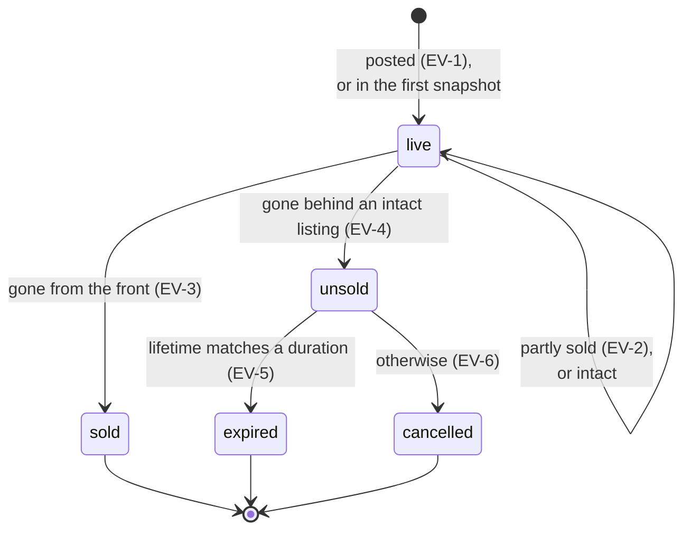

# Listing lifecycle and events

How Dark Portal turns two consecutive snapshots of the EU commodities auction
house into the events that happened between them, and what each event changes.
The auction house model behind it is in [5.1.1](5.1.1-architecture.md); the
tables named here are defined in [5.4.2](5.4.2-storage-schema.md) and their
columns in [5.4.5](5.4.5-data-dictionary.md).

> **Draft for #7's design.** Covers commodities only. Items sold on a realm's
> own auction house (gear) have their own lifecycle, written with WP E.

## The queue

Each commodity has one queue in the auction house: its listings ordered by unit
price ascending, then by auction id descending, so the head is the cheapest and,
at that price, the newest. A buyer always takes units from the head, and one
purchase can take several listings.

Auction ids increase between snapshots: every new id is above the previous
snapshot's highest. So id order is posting order across snapshots (certain),
and only approximately within one, since ids may not be issued in order locally.

## Times

A snapshot's hour is the *hour starting* of its `last-modified` time: a
snapshot modified at 01:31:40 is hour 01:00. Every event is dated by the hour
of the snapshot that first showed it. A duration is the difference of two such
hours, so a recorded duration *n* means between *n − 1* and *n + 1* hours.

## The events

The hourly comparison takes the previous snapshot *P* and the current one *C*.
For each item, it orders *P*'s listings as the queue and marks each one:

- **intact**: in *C* with the same quantity;
- **reduced**: in *C* with a lower quantity;
- **gone**: not in *C*.

The *front* of an item's queue is every listing ahead of its first intact
listing. With no intact listing, the whole queue is the front.

| Event | When | Units | Tier | Rule |
| --- | --- | --- | --- | --- |
| posted | an id in *C* not in *P* | its quantity | certain | EV-1 |
| partly sold | a reduced listing | the drop | certain | EV-2 |
| sold | a gone listing in the front | its quantity | inferred | EV-3 |
| unsold | a gone listing behind an intact one | its quantity | certain | EV-4 |
| expired | an unsold listing whose lifetime matches a duration | its quantity | inferred | EV-5 |
| cancelled | any other unsold listing | its quantity | inferred | EV-6 |

**EV-1** A new id is a posting. An id at or below *P*'s highest is recorded as
an anomaly, since the queue model says it cannot happen.

**EV-2** A quantity drop is a partial sale. A reduced listing behind an intact
one is recorded as an anomaly as well as a sale: buyers take from the head.

**EV-3** A listing gone from the front was sold. Inferred, because a seller can
cancel a listing at the head.

**EV-4** A listing gone from behind an intact one was not sold. Certain, except
where the intact listing has the same price and was first seen in the same
snapshot: their order then rests on local id order, and the tier is inferred.

**EV-5** An unsold listing expired when its posting hour plus 12, 24 or 48
hours is the current hour or the one before. Where its posting hour is unknown
(it was in the first snapshot collected, or after a gap), it expired when its
last time-left band was `SHORT` or `MEDIUM`.

**EV-6** Every other unsold listing was cancelled.

Every event records its tier and its rule, so an inference can be recomputed
when a rule changes without touching the certain facts beneath it.

### A missed hour

Blizzard keeps no history, so a missed snapshot is lost. The comparison then
runs from the last snapshot held to the current one, and every event it finds
is dated to the current hour with a flag saying how many hours the comparison
spans. The listings first seen after a gap have no posting hour.

## A listing's states



A live listing is a row in silver's live listings, with one history row for
every hour it was seen: its quantity, its time-left band and its place in the
queue. When it ends, its listing record is written and its live rows are
removed.

## What each event changes

The entity/event matrix: **C** creates a row, **U** updates one, **R** reads,
**D** deletes.

| Event | snapshot (bronze) | live listing (silver) | listing history (silver) | event (silver) | listing record (silver) | item hour (gold) | item day (gold) |
| --- | --- | --- | --- | --- | --- | --- | --- |
| snapshot collected | C | R | | | | | |
| posted | R | C | C | C | | U | |
| intact | R | U | C | | | | |
| partly sold | R | U | C | C | | U | |
| sold, expired or cancelled | R | D | D | C | C | U | |
| hour closed | | R | | R | | C | |
| day closed | | | | | | R | C |

*Item hour* is written once the hour's events are in: its prices and depth come
from the live listings, and its flows from the events.

## The key types

The collector and the transform share these types. The transform's logic is
SQL; the types fix the columns it reads and writes.

```rust
/// A price in copper: 1 gold is 100 silver is 10,000 copper.
pub struct Copper(pub u64);
pub struct ItemId(pub u32);
pub struct AuctionId(pub u64);
/// The hour starting, as whole hours since the Unix epoch, UTC.
pub struct Hour(pub i64);

pub enum TimeLeft { Short, Medium, Long, VeryLong }
pub enum Duration { H12, H24, H48 }

/// One listing as a snapshot shows it.
pub struct Listing {
    pub id: AuctionId,
    pub item: ItemId,
    pub unit_price: Copper,
    pub quantity: u32,
    pub time_left: TimeLeft,
}

pub enum Tier { Observed, Certain, Inferred }
pub enum Rule { Ev1, Ev2, Ev3, Ev4, Ev5, Ev6 }
pub enum EventKind { Posted, PartlySold, Sold, Unsold, Expired, Cancelled }

pub struct Event {
    pub hour: Hour,
    pub listing: AuctionId,
    pub item: ItemId,
    pub kind: EventKind,
    pub units: u32,
    pub unit_price: Copper,
    pub tier: Tier,
    pub rule: Rule,
    /// Hours since the last snapshot held: 1 unless one was missed.
    pub span: u8,
}

/// The queue around one listing at one hour.
pub struct QueuePlace {
    pub lowest: Copper,
    pub position: u32,
    pub units_ahead: u64,
    pub units_at_or_below: u64,
}

pub enum Outcome { Sold, Expired, Cancelled }

/// One row per listing, written when it ends.
pub struct ListingRecord {
    pub id: AuctionId,
    pub item: ItemId,
    pub unit_price: Copper,
    pub quantity: u32,
    /// None where the listing was in the first snapshot or followed a gap.
    pub posted: Option<Hour>,
    pub duration: Option<Duration>,
    pub at_posting: Option<QueuePlace>,
    pub ended: Hour,
    pub outcome: Outcome,
    pub outcome_tier: Tier,
    pub units_sold: u32,
    pub at_end: QueuePlace,
}
```
