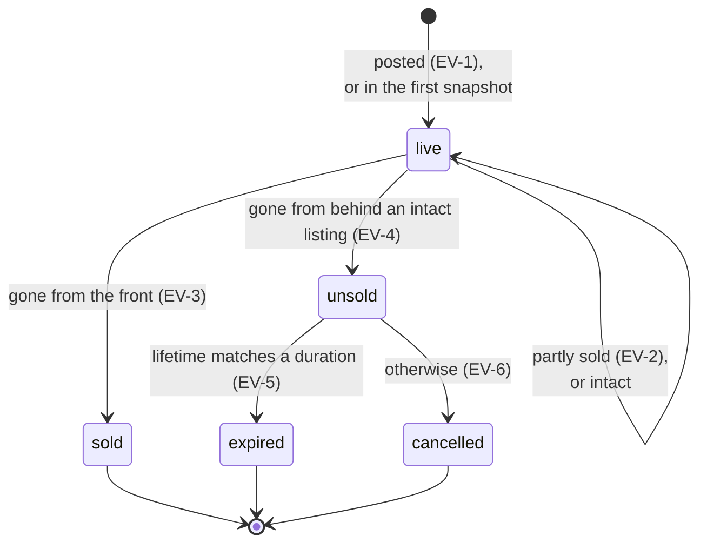

# Listing lifecycle and events

How `dp transform` turns each new snapshot of the EU commodities auction house
into the events that happened since the one before, and what each event
changes. The queue it rests on is in
[5.1.1](5.1.1-architecture.md#the-auction-house-as-the-data-shows-it); the
tables are in [5.4.2](5.4.2-storage-schema.md) and their columns and types in
[5.4.5](5.4.5-data-dictionary.md).

> **Draft for #7's design.** Covers commodities only. Items sold on a realm's
> own auction house (gear) have their own lifecycle, written with stage 4
> (#10).

## Times

A snapshot's hour is the *hour starting* of its `last-modified` time: a
snapshot modified at 01:31:40 is hour 01:00. Every event is dated by the hour
of the snapshot that first showed it.

- *Elapsed hours* are the difference of two such hours, so a recorded *n*
  means between *n − 1* and *n + 1* hours.
- An hour is *held* where its snapshot was processed, and missed otherwise.
- A listing's *lifetime* is the elapsed hours from its posting hour to the
  hour it was first missing.
- A listing's *duration* is the 12, 24 or 48 hours it was posted for.
- A comparison's *span* is the elapsed hours since the last snapshot held: 1,
  unless a snapshot was missed.

## How sure a fact is

Every fact carries a *tier*:

- **observed**: read from a snapshot, such as a listing's quantity;
- **certain**: deduced from two snapshots with no assumption;
- **inferred**: deduced with an assumption the rule names.

An inference can be recomputed when its rule changes, without touching the
facts beneath it.

## A listing's states

A *live* listing is a row in silver's live listings, with one history row for
every hour it was seen: its quantity, its time-left band and its place in the
queue. When it ends, its listing record is written and its live rows are
deleted. *Unsold* is a step in deciding, not a state a listing rests in: each
unsold listing ends expired or cancelled in the same comparison.

## The events

The comparison takes silver's live listings, as of the last hour processed,
and the current snapshot *C*. The first snapshot collected has nothing to
compare with: its listings become live with no posting hour, and it writes no
events. Its hour is held, with prices and depth, and with its flows and span
null. For each later snapshot, the comparison orders each item's live listings
as the queue and marks each one:

- **intact**: in *C* with the same quantity;
- **reduced**: in *C* with a lower quantity;
- **gone**: not in *C*.

The *front* of an item's queue is every listing ahead of its first intact
listing. With no intact listing, the whole queue is the front.

| Event | When | Units | Tier | Rule |
| --- | --- | --- | --- | --- |
| posted | an ID in *C* not live | its quantity | certain | EV-1 |
| partly sold | a reduced listing | the drop | certain | EV-2 |
| sold | a gone listing in the front | its quantity | inferred | EV-3 |
| expired | a gone listing behind an intact one, whose lifetime matches a duration | its quantity | inferred | EV-4, EV-5 |
| cancelled | any other gone listing behind an intact one | its quantity | inferred | EV-4, EV-6 |

**EV-1**: a new ID is a posting. An ID at or below the highest live ID is
still a posting, and is logged as a warning naming it, since IDs increase
between snapshots. An ID that ended and reappears, whatever its value, is
logged the same way and left out, since its record is written: it has no event
and no live row, and it takes no place in the queue, so no other listing's
place counts its units. The check is against every listing record.

**EV-2**: a quantity drop is a partial sale of the drop, priced at the
listing's current price. A reduced listing behind an intact one is recorded as
a sale and logged as a warning naming it, since buyers take from the head.

**EV-3**: a listing gone from the front was sold, for the quantity it had when
last seen. Inferred, because a seller can cancel a listing at the head.

**EV-4**: a listing gone from behind an intact one is unsold. Certain, except
where every intact listing ahead of it has the same price as the gone listing
and the same first-seen hour: their order then rests on ID order within one
snapshot, and the event is marked as a *tie*. Only an expired or cancelled
event can be a tie.

**EV-5**: an unsold listing expired when:

- its posting hour is known, and its posting hour plus 12, 24 or 48 hours
  falls between the hour *span* hours before the current one and the current
  hour, inclusive, the shortest such duration being recorded; or
- its posting hour is unknown, and the lower bound of its last time-left
  band ([5.4.5](5.4.5-data-dictionary.md#types)) is under *span* hours.

**EV-6**: every other unsold listing was cancelled.

Each gone listing writes one event, sold, expired or cancelled:

- its `rule` is the rule that chose the kind: EV-3, EV-5 or EV-6;
- an expired or cancelled kind records that it was unsold, certain by EV-4,
  and its `tie` marks EV-4's exception, where that rests on ID order;
- its `tier` is that of the choice between sold, expired and cancelled.

### A time left that is not a band

A snapshot may give a `time_left` that is not one of the four bands
([5.4.5](5.4.5-data-dictionary.md#types)). The value is kept as given in
bronze and in silver's `time_left`, the hour is processed as any other, and
the hour warns `TIME_LEFT_UNKNOWN`
([5.2.1](5.2.1-collection.md#when-blizzards-response-changes)). Only EV-5
reads a band, and an unknown one has no lower bound, so its second condition
cannot hold: a listing with an unknown time left and no posting hour that
goes missing from behind an intact one is *cancelled* (EV-6), never *expired*.
No time left reaches the sold floor, which is EV-2's drops alone, or turns a
disappearance into a sale: sold stays EV-3's, which does not read it.

### A live listing that changes

A live listing's quantity or price is not meant to change except by a sale.
Where it does, the listing is kept as it is now, with no event, and a warning
names it:

- a quantity that rises counts as *intact*, since the listing is there and
  nothing was taken from it; its units sold are still the drops and, if it
  sells, the quantity it then held, so they can exceed its first quantity;
- a price that changes is kept, and the marks go by quantity alone.

### A missed hour

A missed snapshot is lost, since Blizzard keeps no history. The next
comparison then runs from the live listings to the current snapshot, and every
event it finds is dated to the current hour, with its *span*. The listings it
first sees have no posting hour and no queue at posting, and the missed hours
are recorded in `meta.gap`, each a warning `HOUR_MISSED`. Only an hour missing
between two snapshots held is recorded, in the later hour's transaction: a
latest hour not yet collected is found by a later run.

## What each event changes

The entity/event matrix: **C** creates a row, **U** updates one, **R** reads,
**D** deletes. *Intact* is a mark, not an event, and is listed because it
writes a history row.

| Event or step | Bronze file | `live_listing` | `listing_hour` | `event` | `listing_record` | `item_hour`, `price_level_hour` | `item_day` | `meta` |
| --- | --- | --- | --- | --- | --- | --- | --- | --- |
| snapshot collected | C | | | | | | | |
| snapshot missed | | | | | | | | C `gap` |
| posted | R | C | C | C | | | | |
| intact | R | U | C | | | | | |
| partly sold | R | U | C | C | | | | |
| sold, expired or cancelled | R | D | D | C | C | | | |
| hour closed | | R | | R | | C | | C `processed` |
| day closed | | | | | | R | C | |

The hour's gold rows are written once its events are in: prices and depth from
the live listings, flows from the events. `item_day` is written by `dp daily`.

## The listing record

Written when a listing ends, in three parts:

- **at posting**: the queue around it when first seen, where its posting hour
  is known;
- **the listing**: its ID, item, price, quantity, first and last hours seen,
  posting hour and duration, where known;
- **the outcome**: how it ended and how sure that is, the units sold, and the
  queue at the end, including the units in listings with higher IDs at a lower
  price.

So each record can be classed by how it ended, for example *cancelled after
being undercut by more units than it sold while listed*. Its columns are in
[5.4.2](5.4.2-storage-schema.md#silver).
