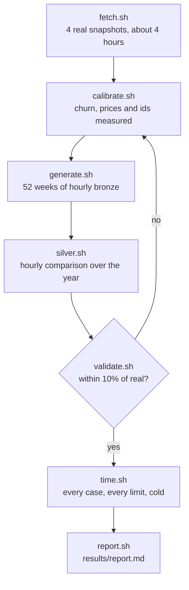

# Sizing test

The scripts for [#12](https://github.com/delphside/dark-portal/issues/12)'s
large-volume test. They build a synthetic year of hourly commodity snapshots
from real ones, run the hourly comparison over it, and time the collection,
the comparison and three analysis queries at several memory limits and thread
counts. The results set the production VM's size, the `memory_limit` and
`threads` settings, and constraints on #5's design.

The scripts are test tooling, not the application: nothing here ships in the
image. The SQL is a prototype of the collection step and the hourly
comparison, written to be timed. #7 designs the real ones.

## What runs



| step | what it does | time on 3 OCPU, estimated |
| --- | --- | --- |
| `setup.sh` | installs DuckDB 2.0.0 and GNU `time`, makes the folders | a minute |
| `fetch.sh` | fetches real commodity snapshots with the non-production Blizzard client until it has four, and loads each with the collection step | about 4 hours, unattended |
| `calibrate.sh` | runs the comparison over the real pairs and measures the generator's parameters into `seed/params.csv` | seconds |
| `generate.sh` | the synthetic year in `bronze/week=NN/`, one file an hour | under an hour |
| `silver.sh` | the comparison over every hour, into `silver/week=NN/` | under an hour |
| `validate.sh` | rows, size and churn per snapshot, real against each synthetic week | minutes |
| `time.sh` | each case at each memory limit and thread count, with the page cache dropped first | hours: see below |
| `report.sh` | `results/report.md`: the machine, the parameters, the validation, the timings and the disk per week | seconds |

`all.sh` runs everything after `calibrate.sh` in order, and stops before the
timings if the validation fails. Every step resumes where it stopped.

## The cases timed

| case | what | memory limits | over |
| --- | --- | --- | --- |
| `read` | a cold `cat` of one bronze week, for the disk's throughput | none | one week |
| `collect` | one real response to bronze | 1, 2 and 4 GB | one snapshot |
| `compare` | one hourly comparison | 1, 2 and 4 GB | two snapshots |
| `price-W` | each item's daily price profile, from bronze | 4, 8 and 12 GB | the last 4, 26 and 52 weeks |
| `volume-W` | each item's daily sales and value, from silver | 4, 8 and 12 GB | the same |
| `lifetime-W` | each listing's posting joined to its end, from silver: the heaviest join | 4, 8 and 12 GB | the same |

Each runs at 1 and 2 threads, three times. Measured: wall time, CPU time,
peak resident memory, the largest spill, and the exit status. A run that
fails, for example out of memory, is recorded as failed, which is a result
too. `MEMS`, `SMALL_MEMS`, `THREADS`, `REPEATS`, `COLD` and `TIMEOUT` change
the matrix.

The year-long scans read the whole of bronze from the boot volume, so they
are probably limited by the disk rather than the CPU. Two passes give the
curve sooner: `REPEATS=1 ./all.sh`, then `./time.sh` again, which adds the
second and third repeats.

## Running it on the non-production VM

As `ubuntu`, which can read E5's Blizzard file through `sudo` and drop the
page cache. The data goes to `~/sizing-data`, about 35 GB at real volumes.

```bash
git clone https://github.com/delphside/dark-portal.git ~/dark-portal
cd ~/dark-portal/sizing
./setup.sh
nohup ./fetch.sh >~/fetch.out 2>&1 &
```

When `tail ~/sizing-data/seed/raw/fetch.log` says `done`:

```bash
./calibrate.sh
nohup ./all.sh >~/sizing.out 2>&1 &
```

`tail ~/sizing.out` shows progress. When it ends, send back
`~/sizing-data/results/report.md`. It holds no credentials and no address.
Afterwards, `rm -rf ~/sizing-data` gives the disk back.

## Trying it without the API

`test/fake-seed.sh` writes four made-up responses, in Blizzard's format and at
about real size, in place of `fetch.sh`. Then run with fewer weeks and a
smaller matrix:

```bash
export SIZING_DATA=/tmp/sizing-data SIZING_WEEKS=2 COLD=0 REPEATS=1
./setup.sh && test/fake-seed.sh && ./calibrate.sh && ./all.sh
```

The fake data's numbers mean nothing for sizing.

## How the synthetic year is made

The last real snapshot is the starting state. Each hour:

1. Each item's queue is ordered by price, newest first, as the comparison
   reads it. A number of listings are bought whole from its front, the
   measured share on average, and sometimes the next one is part-bought.
2. Listings past their expiry hour go. Others behind the front are cancelled
   at the measured rate.
3. New postings bring the count back to the real count, give or take 5% over
   the day. Each copies an existing listing's item and quantity. The measured
   share undercut the item's lowest price; the rest take the copied price
   within 10%. Durations are 12, 24 or 48 hours, with the measured share at
   12. Ids rise at the measured step.

Assumed rather than measured: the daily swing, the 10% price spread, the
split between 24 and 48 hours, and how far a part-buy takes a quantity down.
Only rows, size and churn are tested against the real snapshots.
