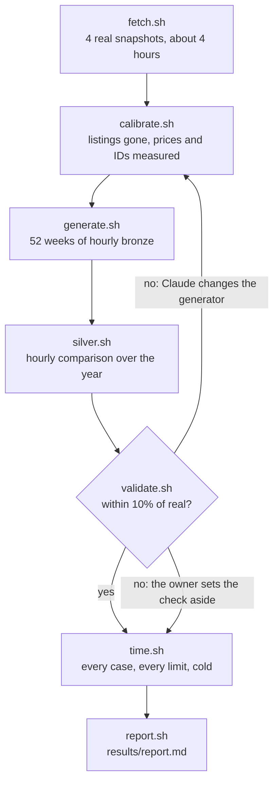

# Sizing test

The scripts for [#12](https://github.com/delphside/dark-portal/issues/12)'s
large-volume test. They build a synthetic year of hourly commodity snapshots
from real ones, run the hourly comparison over it, and time the collection,
the comparison and three analysis queries at several memory limits and thread
counts. The results set the production VM's size, the `memory_limit` and
`threads` settings, and constraints on
[#5](https://github.com/delphside/dark-portal/issues/5)'s design.

The scripts are test tooling, outside the image. The SQL is a prototype of the
collection step and the hourly comparison, written to be timed;
[#5](https://github.com/delphside/dark-portal/issues/5) designs the real ones
and [#7](https://github.com/delphside/dark-portal/issues/7) builds them.

*Bronze* is the snapshots as collected, one Parquet file an hour. *Silver* is
the hourly comparison's output: the listings posted, sold, part-sold,
cancelled and expired between one snapshot and the next.

## What runs



The times are estimates for the VM the test first ran on: 3 OCPU (Oracle's
unit of CPU) and 18 GB.

| Step | What it does | Time, estimated |
| --- | --- | --- |
| [`setup.sh`](setup.sh) | installs DuckDB 2.0.0 and GNU `time`, makes the folders | a minute |
| [`fetch.sh`](fetch.sh) | fetches real commodity snapshots from Blizzard's API, with the client in `BLIZZARD_ENV`, until it has four, and loads each with the collection step | about 4 hours, unattended |
| [`calibrate.sh`](calibrate.sh) | runs the comparison over the pairs of real snapshots and measures the generator's inputs into `seed/`; removes the synthetic year and every result, the timings included | seconds |
| [`generate.sh`](generate.sh) | the synthetic year in `bronze/week=NN/`, one file an hour | under an hour |
| [`silver.sh`](silver.sh) | the comparison over every hour, into `silver/week=NN/` | under an hour |
| [`validate.sh`](validate.sh) | rows, size, listings gone, items, quantities and prices, real against each synthetic week | minutes |
| [`time.sh`](time.sh) | each case at each memory limit and thread count, with the page cache dropped first | hours: 201 runs at the defaults, each at most `TIMEOUT` |
| [`report.sh`](report.sh) | `results/report.md`: the machine, the parameters, the validation, the timings and the disk per week | seconds |

[`all.sh`](all.sh) runs everything after `calibrate.sh` in order, and stops
before the timings if the validation fails. Each of its steps resumes where it
stopped.

The folder also holds:

- [`lib.sh`](lib.sh): the settings and functions every script sources;
- [`sql/`](sql/): the SQL each step and case runs;
- [`test/`](test/): `fake-seed.sh`, for a trial without Blizzard's API;
- [`results/`](results/): the first run's report, whose figures the capacity
  plan
  [DP_CP_2026_10](https://github.com/delphside/programme/blob/main/applications/dark-portal/3.2.3-capacity-plan/DP_CP_2026_10.md)
  carries.

## The cases timed

| Case | What | Memory limits | Over |
| --- | --- | --- | --- |
| `read` | a cold `cat` of one bronze week, for the disk's throughput | none | one week |
| `collect` | one real response to bronze | 1, 2 and 4 GB | one snapshot |
| `compare` | one hourly comparison | 1, 2 and 4 GB | two snapshots |
| `price-W` | each item's daily price profile, from bronze | 4, 8 and 12 GB | the last 4, 26 and 52 weeks |
| `volume-W` | each item's daily sales and value, from silver | 4, 8 and 12 GB | the same |
| `lifetime-W` | each listing's posting joined to its end, from silver: the heaviest join | 4, 8 and 12 GB | the same |

At the defaults, every case but `read` runs at 1 and 2 threads, and every
case runs three times; `read` runs at 1 thread with no limit. `time.sh`
measures, for each run:

- wall time;
- CPU time;
- peak resident memory;
- the largest spill;
- for `read`, the bytes read;
- the exit status.

A run that fails, for example out of memory, counts as failed in the report,
with its first error, and its output stays in `results/logs/`. At the
defaults, `time.sh` skips a run already recorded, failed or not.

Two passes give a first timing of every case sooner, since a year-long case
can take 24 minutes a run (`lifetime-52` in the first run). The second
`time.sh` adds the second and third repeats:

```bash
REPEATS=1 ./all.sh
./time.sh && ./report.sh
```

## Settings

Each is an environment variable.

| Variable | Sets | Default |
| --- | --- | --- |
| `SIZING_DATA` | where the data and the results go | `~/sizing-data` |
| `SIZING_WEEKS` | the weeks in the synthetic year; each case longer than this is left out | 52 |
| `SIZING_START` | the synthetic year's first hour, a Monday | `2025-10-27 00:00:00` |
| `SIZING_MAXOBJ` | the largest response, in bytes, the collection step accepts | 268435456 (256 MB) |
| `DUCKDB` | the DuckDB binary | `bin/duckdb` under `SIZING_DATA` |
| `BLIZZARD_ENV` | the file holding the Blizzard client, which `fetch.sh` reads | `/srv/dp/e5/blizzard.env` |
| `MEMS` | the memory limits of the analysis queries, in GB | `4 8 12` |
| `SMALL_MEMS` | the memory limits of `collect` and `compare`, in GB | `1 2 4` |
| `THREADS` | the thread counts | `1 2` |
| `REPEATS` | the runs of each case at each limit and thread count | 3 |
| `COLD` | with 1, drops the page cache before each run, and stops if it cannot | 1 |
| `TIMEOUT` | the seconds a run may take before it is stopped | 7200 |
| `SPILL_MAX_GB` | the most a run may spill, in GB | the free disk less 2 GB |
| `RETRY_FAILED` | with 1, runs the failed runs again | 0 |

## Running it on the non-production VM

Run it as `ubuntu`, which can drop the page cache. Through `sudo`, `ubuntu`
can also read the Blizzard client of E5, the technical and load-testing
environment. The VM has 2 OCPU and 12 GB, where a 12 GB limit leaves the
system nothing, so each `all.sh` and `time.sh` on it runs with `MEMS="4 8"`,
the two-pass run included.

The data goes to `SIZING_DATA`, `~/sizing-data` by default, and the paths
in this section are at that default. It takes 20 to 40 GB at real volumes,
with room to spill, depending on how well the real data compresses. That fits
the VM's free disk only while a bronze week is under about 0.5 GB. From week
2 on, `generate.sh` checks the free disk against week 1's size, and stops if
the rest of the year will not fit. Then do one of these:

- grow the boot volume;
- move `~/sizing-data` to a larger disk and set `SIZING_DATA` to it;
- set `SIZING_WEEKS` lower.

Avoid starting `fetch.sh` on a Wednesday morning, when Blizzard's EU
maintenance can hold the data still for hours.

```bash
git clone https://github.com/delphside/dark-portal.git ~/dark-portal
cd ~/dark-portal/sizing
./setup.sh
nohup ./fetch.sh >~/fetch.out 2>&1 &
```

Once `fetch.sh` has exited, read the end of `~/sizing-data/seed/raw/fetch.log`:

- `done: 4 snapshots`: run the block below;
- anything else: `~/fetch.out` says why; run `fetch.sh` again, which keeps the
  snapshots it has.

```bash
./calibrate.sh
MEMS="4 8" nohup ./all.sh >~/sizing.out 2>&1 &
```

If `calibrate.sh` stops for too few pairs, `./fetch.sh 6` fetches two more.

After starting `all.sh`:

1. Follow progress with `tail ~/sizing.out`.
2. When it ends, send `~/sizing-data/results/report.md` to Claude. It holds no
   credentials and no address. If it stopped on the validation, there is no
   report: `~/sizing-data/results/validation.md` says which metric failed, and
   [How the synthetic year is made](#how-the-synthetic-year-is-made) says what
   follows.
3. Once the final `report.md` is with Claude (after the second `time.sh` in
   a two-pass run), run `rm -rf ~/sizing-data` to give the disk back.

## Trying it without the API

`test/fake-seed.sh` writes four made-up responses, in Blizzard's format and at
about real size, in place of `fetch.sh`, so the scripts run without
Blizzard's API. Then run with fewer weeks and a smaller matrix:

```bash
export SIZING_DATA=/tmp/sizing-data SIZING_WEEKS=2 COLD=0 REPEATS=1
./setup.sh && test/fake-seed.sh && ./calibrate.sh && ./all.sh
```

The fake data's numbers mean nothing for sizing.

## How the synthetic year is made

The last real snapshot is the starting state. Each hour:

1. Each item's queue is ordered by price, then newest first, as the
   comparison reads it. A number of listings are bought whole from its front,
   the measured share on average, and sometimes the next one is part-bought.
2. Listings past their expiry hour go. Others behind the front are cancelled
   at the measured rate.
3. An item left with no listings gets one back, at its seed price, as a real
   market keeps its rarer items listed.
4. New postings bring the count back to the real count, give or take 5% over
   the day. Each new posting:
   - draws an item and quantity from the last real snapshot, so both keep the
     real spread all year;
   - is priced at the item's lowest price in that snapshot times a ratio drawn
     from the real postings, each measured against its item's lowest price an
     hour before;
   - then snaps to the nearest price the item had in that snapshot; a price
     above the item's highest stays, and the measured share of those at 1 gold
     or more is rounded to a whole silver coin;
   - lasts 12, 24 or 48 hours, with the measured share at 12;
   - takes an ID that rises at the measured step.

Drawing prices this way holds them steady over the year, which is what sizing
needs.

The split between 24- and 48-hour postings cannot be seen (both show as
`VERY_LONG`), so `calibrate.sh` solves it, approximately, from the measured
expiry rate. Assumed: the daily swing and how far a part-buy takes a quantity
down. Only pairs of real snapshots 45 to 75 minutes apart are measured.

The validation tests six metrics every week, each within 10% of the real
snapshots:

| Metric | What it is | Held by |
| --- | --- | --- |
| `rows_per_snapshot` | rows per snapshot | construction |
| `mb_per_snapshot` | size per snapshot | nothing: it shows drift |
| `gone_rate` | the share of listings gone each hour | calibration |
| `items` | distinct items | construction |
| `mean_quantity` | mean quantity | nothing: it shows drift |
| `price_ratio` | the median, over items, of each item's price against its real price | nothing: it shows drift |

When one fails, one of these follows, each with the machine's `MEMS`:

- Claude changes the generator; the owner pulls it into `~/dark-portal`, then
  runs `./calibrate.sh`, which clears the year, and `all.sh` again;
- the owner sets the check aside, then `./time.sh && ./report.sh` times the
  year as it is.
